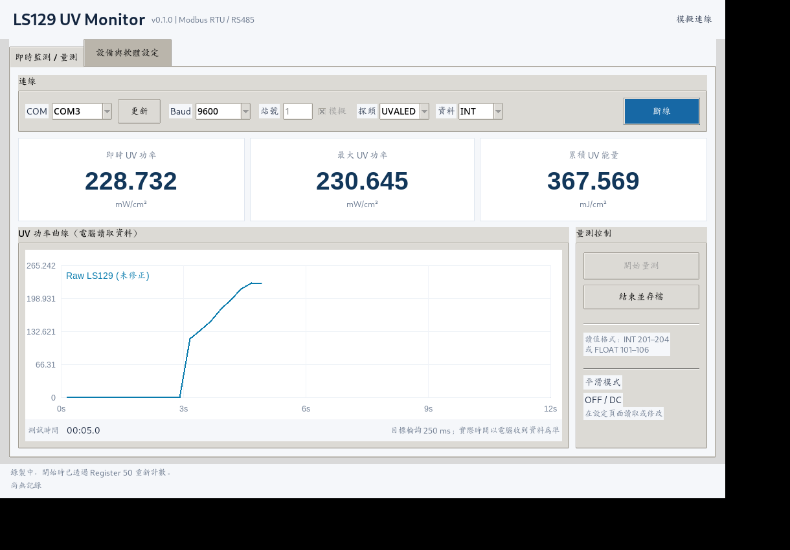

# LS129 UV Monitor / 林上 LS129 紫外線監測軟體

**Version / 版本：v0.1.0 (2026-11-19)**

A Windows desktop application for the **Linshang LS129** UV sensor via **Modbus RTU over RS485**. Designed with the LS128 PC software as an interface reference, but operates as a live monitor and recording tool rather than downloading a historical curve from the meter.

這是林上 **LS129** 紫外線感測器的 Windows 桌面程式，透過 **RS485 / Modbus RTU** 進行即時監控、量測紀錄與 CSV 匯出。介面參考 LS128，但因 LS129 沒有螢幕、量測資料由電腦端保存，操作流程有所不同。

> **Status / 狀態：** Initial prototype. Tested with simulated data and Modbus frame decoding; the program has **not yet been validated end-to-end with a physical LS129**. Do not treat it as a calibrated metrology system without verification.
>
> 初版原型：已做模擬模式及 Modbus 封包解析測試，**尚未以實體 LS129 完成程式端到端驗證**；正式量測使用前請校驗設定、單位及讀值。



## Features / 功能

- Live power, peak power and accumulated UV energy / 即時功率、最大功率、累積能量
- RS485 connection via COM port; 9600 baud, 8N1 by default / COM 連線，預設 9600、8N1
- Modbus RTU CRC16 verification / Modbus RTU CRC16 驗證
- INT registers **201–204**, experimental FLOAT registers **101–106** / 整數及實驗性浮點資料讀取
- Live curve and manual start/stop recording / 即時曲線、手動開始／結束量測
- Timestamped UTF-8 BOM CSV export / 含時間戳的 CSV（Excel 可開啟）
- Read / write **smoothing mode** (OFF, 50 Hz, 60 Hz) via register 320, with read-back verification / 光源平滑設定讀寫驗證
- Software-only EIT comparison factor, **OFF by default** / 預留 EIT 電腦端修正，不寫入探頭
- Demo mode without hardware / 無硬體模擬模式

**Safety / 安全：** In v0.1, writes are limited to register **50** (reset peak/energy statistics on measurement start) and **320** (smoothing mode, initiated by user). It never writes the LS129 external calibration register. 本版不會寫入 LS129 外部校正係數。

## System requirements / 系統需求

- Windows 7 32-bit target / 以 Windows 7 32-bit 為目標
- Python 3.7.9 (with Tkinter/Tcl-Tk) / Python 3.7.9，需包含 Tkinter
- PySerial 3.5 for hardware mode / 實機通訊需 pyserial 3.5
- USB–RS485 adapter such as **ATK-MO340P** (set to USB-485 mode) / 轉接模組使用 USB-485 模式
- Proper external power supply to LS129 / LS129 使用適當外部供電

### Installation / 安裝

```bash
python -m pip install -r requirements.txt
python LS129_Monitor.py
```

You can alternatively launch `啟動_LS129.bat` on Windows. For demo mode, tick **模擬** before connecting. To use the real sensor, close AccessPort or any other application occupying the COM port.

Windows 可直接執行 `啟動_LS129.bat`；沒有探頭時先勾選「模擬」。實機連線前請關閉 AccessPort，以免同一 COM Port 被占用。

### Self-test / 自我測試

```bash
python LS129_Monitor.py --self-test
```

Expected / 預期：`SELF TEST OK` (CRC16, integer/float decoding, settings response, reset command).

## Data output / 資料輸出

Upon **結束並存檔**, the app creates `Records/*.csv` with original readings (`*_raw`), PC-corrected values (`*_pc`), correction factor, timestamp, probe settings and `response_hex`. `Records/` is excluded from version control to avoid accidentally publishing measurement data.

按「結束並存檔」後自動建立 `Records/*.csv`，同時保存原始值、電腦端修正值、時間戳、探頭設定和通訊回覆封包。`Records/` 不會納入 Git，以避免將實測資料意外公開。

## Known limitations / 目前限制

- **4 Hz target polling**, not a guaranteed hardware data rate / 預設每 250 ms 輪詢，實際時間會受系統與通訊延遲影響
- Curve points are PC-received Modbus values, **not** the LS129 internal 2048 Hz measurements / 曲線並非探頭內部 2048 Hz 原始資料
- The actual LS129 FLOAT response format, units and measurement behavior require device verification / FLOAT 格式、單位與實機行為仍待確認
- One sensor only; no history browser, automatic trigger or PDF reports / 目前單探頭，尚無自動觸發與 PDF 報表
- EIT correction is PC-side only; no writing calibration coefficients to the device / EIT 只在軟體端修正

## Planned validation / 下一步測試構想（未實作）

- Display power/peak/energy rounded to one decimal place, while preserving full precision in raw recordings / 主畫面顯示到小數第一位，原始資料不捨入
- Compare Modbus polling at 4, 5 and **20 Hz** under changing illumination, preserving each query's timestamp, raw response and duplicate patterns / 比較 4、5、20 Hz 輪詢，保留每筆時間戳、HEX 回覆及重複值分布
- **Important:** if LS129 refreshes at 5 Hz, 20 Hz polling may produce approximately four identical readings per update, but not necessarily groups of exactly four due to asynchronous clocks and serial latency / 20 Hz 輪詢不保證四筆恰好一組，需實測時戳與回覆值

## Protocol / 通訊協議

[Linshang LS129 Communication Protocol V3.2](https://images.linshangtech.com/user-manual/LS129_Communication_Protocol_V3.2.pdf)

No license is assigned in this first release; licensing is left to the repository owner. / 本版尚未指定授權條款，由專案擁有者決定。
